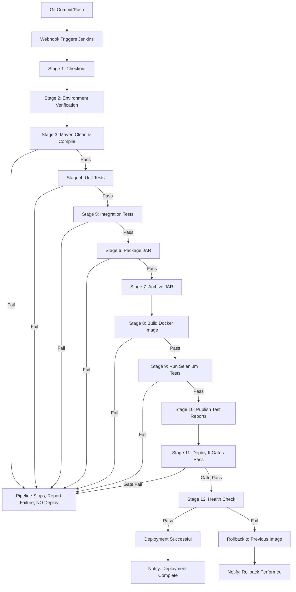

# DevOps Workflow

## 1. CI/CD Pipeline Overview

The Jenkins Pipeline (Jenkinsfile) implements a 12-stage CI/CD pipeline from code commit to deployment with quality gates at each stage. The pipeline is triggered on Git commits via GitHub webhook (or polling as alternative).

### 1.1 Pipeline Stages

| Stage | Number | Description | Quality Gate |
|-------|--------|-------------|--------------|
| **1** | Checkout | Retrieve source code from GitHub repository | None (always runs) |
| **2** | Environment and Java Version Verification | Check Java version (21+), Maven availability, environment variables | None |
| **3** | Maven Clean and Compile | `mvnw clean compile` — compile Java source code | Compile must succeed |
| **4** | Unit Tests | `mvnw test` — run JUnit 5 + Mockito tests | All tests pass |
| **5** | Integration Tests | `mvnw verify` — run Spring Boot integration tests with H2 | All tests pass |
| **6** | Package the Application | `mvnw package` — create JAR artifact | JAR built successfully |
| **7** | Archive the JAR Artifact | Archive `target/streetlight-*.jar` as build artifact | Artifact archived |
| **8** | Build a Docker Image | `docker build` — create image from Dockerfile | Image built tag |
| **9** | Run Selenium Tests against Deployed App | Deploy to test container, run Selenium WebDriver tests | All 5 user journey tests pass |
| **10** | Publish Test Reports | Publish JUnit and Selenium test reports to Jenkins | Reports archived |
| **11** | Deploy Only If Quality Gates Pass | Conditional: deploy only if stages 1-9 all passed | All prior gates green |
| **12** | Deployment Health Check | `curl` or actuator `/actuator/health` — verify app running | Health check passes |

### 1.2 Pipeline Flow Diagram (Mermaid)



### 1.3 Trigger Mechanisms

| Trigger Type | Configuration | Behavior |
|--------------|---------------|----------|
| **GitHub Webhook** | `postReceive` hook on GitHub repo | Pushes commit immediately to Jenkins; fastest |
| **Polling (Alternative)** | Jenkins poll SCM schedule (`H/5 * * * *`) | Checks GitHub every 5 minutes for changes; reliable if webhook fails |
| **Manual Trigger** | Jenkins UI "Build with Parameters" | Runs pipeline on demand; useful for release testing |

**Webhook Configuration**:
- GitHub repo Settings → Webhooks → Add webhook
- Payload URL: `http://jenkins:8080/github-webhook/`
- Content type: `application/json`
- Secret: configured in Jenkins credentials
- Events: just push

**Polling Syntax** (in Jenkinsfile or job config):
```
H/5 * * * *  (every 5 minutes)
```

## 2. Jenkins Configuration

### 2.1 Jenkinsfile (Pipeline Script)

The Jenkinsfile is located at the repository root and defines the complete pipeline. Key features:

- **Parameterized configuration** for Docker image name, tag, registry
- **Quality gates** at stages 9 and 11 (Selenium tests and deployment)
- **Archive artifacts** for JAR and Docker image
- **Publish test reports** (JUnit, Selenium screenshots)
- **Health check** on deployed application
- **Rollback** on health check failure

```groovy
// Jenkinsfile - simplified key sections
pipeline {
    agent any
    
    environment {
        // Docker configuration (from Jenkins credentials)
        REGISTRY = credentials('docker-hub-registry')
        IMAGE_NAME = 'streetlight/fault-reporting'
        IMAGE_TAG = "${env.BUILD_NUMBER}"
        DOCKER_CRED_ID = 'docker-hub-credentials'
        
        // Application configuration
        APP_NAME = 'streetlight-fault-reporting'
        MAVEN_OPTS = '-Dspring.profiles.active=test'
        
        // Quality gate flags
        DEPLOY_ENABLED = true
    }
    
    stages {
        stage('1. Checkout') {
            steps {
                git branch: env.GIT_BRANCH, url: env.GIT_REPO_URL
                // or: checkout scm
            }
        }
        
        stage('2. Environment and Java Version Verification') {
            steps {
                // Verify Java version
                sh 'java -version'
                // Verify Maven wrapper is available
                sh './mvnw --version'
                // Check environment variables
                env.MAVEN_OPTS ? 'MAVEN_OPTS set' : warning 'MAVEN_OPTS not set'
            }
        }
        
        stage('3. Maven Clean and Compile') {
            steps {
                sh './mvnw clean compile -B'
                // fail fast on compile error
            }
        }
        
        stage('4. Unit Tests') {
            steps {
                sh './mvnw test -B -Dtest="*Test"'
                // JUnit 5 tests run; fails if any test fails
            }
        }
        
        stage('5. Integration Tests') {
            steps {
                sh './mvnw verify -B -Dspring.profiles.active=test'
                // Integration tests with Spring Boot Test + H2
            }
        }
        
        stage('6. Package the Application') {
            steps {
                sh './mvnw package -B'
                // produces target/app.jar
            }
        }
        
        stage('7. Archive the JAR Artifact') {
            steps {
                archiveArtifacts artifacts: 'target/streetlight-*.jar', allowEmptyArchive: true
                // JAR available in Jenkins Artifacts section
            }
        }
        
        stage('8. Build a Docker Image') {
            steps {
                // Build using Docker CLI with credentials
                withCredentials([usernamePassword(credentialsId: env.DOCKER_CRED_ID, passwordVariable: 'DOCKER_PASS', usernameVariable: 'DOCKER_USER')]) {
                    sh "docker build -t ${REGISTRY}/${IMAGE_NAME}:${IMAGE_TAG} ."
                    sh "docker login -u ${DOCKER_USER} -p ${DOCKER_PASS} ${REGISTRY}"
                    sh "docker push ${REGISTRY}/${IMAGE_NAME}:${IMAGE_TAG}"
                }
            }
        }
        
        stage('9. Run Selenium Tests against Deployed App') {
            steps {
                // Deploy test app via Docker Compose
                // Then run Selenium tests
                sh '''
                    docker compose -f docker-compose.test.yml up -d
                    sleep 30  // wait for app to start
                    ./mvnw selenium:test  // or surefire with test class
                '''
                // Selenium tests run; fail fast if any test fails
            }
        }
        
        stage('10. Publish Test Reports') {
            steps {
                // Publish JUnit test results
                junit '**/surefire-reports/*.xml'
                // Publish Selenium screenshots/failures
                archiveArtifacts artifacts: 'target/selenium-reports/**', allowEmptyArchive: true
            }
        }
        
        stage('11. Deploy Only If Quality Gates Pass') {
            when {
                expression { return currentBuild.result == 'SUCCESS' }
            }
            steps {
                // Deploy to production Docker Compose
                withCredentials([usernamePassword(credentialsId: env.DOCKER_CRED_ID, passwordVariable: 'DOCKER_PASS', usernameVariable: 'DOCKER_USER')]) {
                    sh "docker compose up -d"
                    // or: deploy to Kubernetes, ECS, etc.
                }
                // Only reaches here if stage 9 (Selenium) passed
            }
        }
        
        stage('12. Deployment Health Check') {
            steps {
                // Wait for app to be ready
                sh '''
                    for i in {1..30}; do
                        if curl -f http://localhost:8080/actuator/health; then
                            echo "Application is healthy"
                            break
                        fi
                        sleep 5
                    done
                '''
                // If loop completes without success, trigger rollback
                if [ "$i" -ge 30 ]; then
                    error "Health check failed after 150 seconds - initiating rollback"
                    // trigger rollback pipeline
                fi
            }
        }
    }
    
    post {
        success {
            echo "🎉 Pipeline completed successfully!"
            // Send notification (Slack, email, etc.)
        }
        failure {
            echo "❌ Pipeline failed"
            // Send failure notification
            // Archive failure artifacts for debugging
        }
    }
}
```

### 2.2 Jenkins Credentials Configuration

| Credential ID | Description | Type | Used By |
|---------------|-------------|------|---------|
| `docker-hub-registry` | Docker Hub registry URL | String | Jenkins environment variable `REGISTRY` |
| `docker-hub-credentials` | Docker Hub username+password | Username/Password | Stage 8: `docker login` and `push` |
| `github-webhook-secret` | GitHub webhook secret | Secret String | Webhook verification (optional) |
| `jenkins-admin-username` | Jenkins admin user | String | Authentication (if needed) |

**How to Configure in Jenkins**:
1. Open Jenkins → Manage Jenkins → Manage Credentials
2. Select `(Jenkins)` or `(global)` domain
3. Click "Add Credentials"
4. Kind: `Username with password` or `Secret text`
5. ID: as listed above
6. Username/password: actual values (kept out of source code)
7. Save

**Never commit credentials to the repository**. The `.gitignore` excludes any credential files.

### 2.3 GitHub Webhook Setup

1. In GitHub repo: Settings → Webhooks → Add webhook
2. Payload URL: `http://<JENKINS_URL>:8080/github-webhook/`
3. Content type: `application/json`
4. Secret: set to some secret (enter in Jenkins credentials as `github-webhook-secret`)
5. Events: select "Just push events"
6. Active: checked

**Alternative: Polling**
- In Jenkins job configuration → "Build triggers"
- Check "Poll SCM"
- Schedule: `H/5 * * * *` (every 5 minutes)
- Jenkins checks GitHub for new commits

## 3. Docker and Deployment Workflow

### 3.1 Docker Image Build and Push

```
Local Development → Jenkins CI → Docker Hub → Production

1. Developer works locally
2. Developer commits to feature branch
3. Push to GitHub triggers Jenkins webhook
4. Jenkins runs pipeline stages 1-12
5. Stage 8: Docker image built and tagged
6. Stage 8: Image pushed to Docker Hub
7. Stage 11: `docker compose up -d` on production target
8. Stage 12: Health check verifies deployment
9. If health check fails: rollback to previous image tag
```

### 3.2 Docker Compose Configuration (Production)

```yaml
# docker-compose.yml (production)
version: '3.8'

services:
  app:
    image: ${DOCKER_IMAGE}:${DOCKER_TAG}
    container_name: streetlight-app
    build:
      context: .
      dockerfile: Dockerfile
    ports:
      - "8080:8080"
    environment:
      - DB_HOST=mysql
      - DB_PORT=3306
      - DB_NAME=${DB_NAME}
      - DB_USER=${DB_USER}
      - DB_PASSWORD=${DB_PASSWORD}
    depends_on:
      mysql:
        condition: service_healthy
    restart: unless-stopped
    healthcheck:
      test: ["CMD", "curl", "-f", "http://localhost:8080/actuator/health"]
      interval: 30s
      timeout: 10s
      retries: 3
      start_period: 40s

  mysql:
    image: mysql:8.0
    container_name: streetlight-mysql
    restart: unless-stopped
    environment:
      - MYSQL_DATABASE=${DB_NAME}
      - MYSQL_ROOT_PASSWORD=${MYSQL_ROOT_PASSWORD}
      - MYSQL_USER=${DB_USER}
      - MYSQL_PASSWORD=${DB_PASSWORD}
    ports:
      - "3306:3306"
    volumes:
      - mysql_data:/var/lib/mysql
    healthcheck:
      test: ["CMD", "mysqladmin", "ping", "-u", "root", "-p${MYSQL_ROOT_PASSWORD}"]
      interval: 10s
      timeout: 5s
      retries: 5

  nginx:
    image: nginx:alpine
    container_name: streetlight-nginx
    restart: unless-stopped
    ports:
      - "80:80"
      - "443:443"
    volumes:
      - ./nginx:/etc/nginx/conf.d:ro
    depends_on:
      app:
        condition: service_healthy

volumes:
  mysql_data:
```

### 3.3 Rollback Procedure

```
Rollback Scenario: New deployment causes application failure

1. Health check fails (stage 12) after deployment
2. Identify previous successful image tag
3. Rollback command: docker compose pull <old-image>
   or: docker tag ${REGISTRY}/${IMAGE_NAME}:<previous> ${IMAGE_NAME}:latest
4. docker compose up -d (restarts with previous image)
5. Health check re-runs; if passes: deployment successful
6. If still fails: escalate to manual intervention

Rollback Documentation:
- Previous image tag stored in: JENKINS_BUILD_PREVIOUS or Docker tag history
- Rollback script: ./scripts/rollback.sh (documented but not auto-executed)
- Rollback verification: health check passes, dashboard metrics restore
```

### 3.4 Health Check Endpoint

```
Endpoint: GET /actuator/health
Response (Spring Boot 3.x):
{
  "status": "UP",
  "components": {
    "database": {"status": "UP"},
    "diskSpace": {"status": "UP"},
    "appHealthCheck": {"status": "UP"}
  }
}

Custom Health Check:
- Application may define @Bean HealthCheckler bean
- Returns specific application status (e.g., "UP" if DB connected, complaints table accessible)
- Used by Jenkins stage 12 and Docker compose healthcheck

Jenkins Health Check Script:
```bash
#!/bin/bash
# Wait for application to be healthy
for i in $(seq 1 30); do
    STATUS=$(curl -s -o /dev/null -w "%{http_code}" http://localhost:8080/actuator/health)
    if [ "$STATUS" = "200" ]; then
        echo "Application healthy (HTTP 200)"
        exit 0
    fi
    echo "Attempt $i: Application not ready, waiting..."
    sleep 5
done
echo "Health check failed after 150 seconds"
exit 1  # This triggers rollback in Jenkins
```
```

## 4. Ansible Provisioning Workflow

### 4.1 Playbook Execution Flow

```
Local Machine → Ansible → Linux Target → Configure → Deploy → Verify

1. ansible-playbook -i inventory.yml site.yml --ask-pass
2. Playbook runs tasks in order:
   a. Install packages (Java, Docker, Docker Compose, Nginx)
   b. Create deployment directories
   c. Copy application configuration (.env, application.yml)
   d. Pull Docker image from registry
   e. Start docker compose
   f. Wait for health check
3. Second run (idempotency): no unnecessary changes (--changed=0)
4. Verification: application accessible, health check passes
```

### 4.2 Ansible Playbook Structure

```
site.yml             ← Main playbook (orchestration)
├── roles/
│   ├── system       ← Package installation, users, directories
│   ├── docker       ← Docker installation, service management
│   ├── application  ← Copy configs, deploy app, restart services
│   └── health       ← Health checks, status verification
├── inventory.yml    ← Target host(s) and connection vars
└── group_vars/      ← Variable groups (all, prod, staging)
```

### 4.3 Idempotency Verification

```bash
# First run - makes changes
ansible-playbook -i inventory.yml site.yml

# Second run - should show no changes (idempotent)
ansible-playbook -i inventory.yml site.yml

# Expected output for second run:
PLAY [streetlight-app] *****************************************************************************
GATHER FACTS                                                                                           ok => [target-host]
...
PLAY RECAP **********************************************************************************************
target-host                    : ok=5   changed=0   unreachable=0   failed=0   skipped=0   rescued=0

# Idempotency confirmed: second run changed=0 (no unnecessary modifications)
```

### 4.4 Recovery from Failed Deployment

```bash
# If Ansible deployment fails partway:
1. ansible-playbook -i inventory.yml site.yml --step-linear  (or run specific roles)
2. Or manually:
   - docker compose down (stop failed containers)
   - docker compose up -d (restart with desired image)
   - Or: docker pull <previous-tag> && docker compose up -d
3. Verify health check passes
4. Re-run ansible-playbook for idempotent recovery

# Rollback steps:
1. Identify previous image tag from Docker history: docker images
2. Pull previous tag: docker pull registry/hub/streetlight/fault-reporting:v1.0.0
3. Re-run ansible with previous tag or docker compose up with specific tag
4. Verify: health check, application accessible, metrics correct
```

## 5. Local Development Workflow

### 5.1 Development Cycle

```
Local → Test → Commit → Push → Jenkins → Deploy → Verify

1. Create feature branch: git checkout -b feature/xxx
2. Implement feature; run locally: ./mvnw spring-boot:run
3. Test manually: open http://localhost:8080
4. Run tests: ./mvnw test
5. If tests pass: commit with conventional message
6. Push to GitHub: git push origin feature/xxx
7. Jenkins webhook triggers pipeline
8. Pipeline runs stages 1-12
9. If all pass: create Pull Request
10. Code review (peers)
11. Merge to develop branch
12. Eventually merge to main (release)
13. Tag release: git tag v1.0.0; git push origin v1.0.0
14. Docker image built and pushed automatically (if on main)
```

### 5.2 Conventional Commit Messages

| Prefix | Type | Description |
|--------|------|-------------|
| `feat:` | Feature | New capability (e.g., "feat: add status history tracking") |
| `fix:` | Bug defect | Bug fix (e.g., "fix: invalid status transition from REPORTED to RESOLVED") |
| `docs:` | Documentation | Docs changes only |
| `style:` | Formatting | Code formatting, no logic change |
| `refactor:` | Refactor | Code restructure, no bug fix/new feature |
| `test:` | Test | Adding missing tests, refactoring test logic |
| `chore:` | Maintenance | Build process, dependency updates, config changes |
| `perf:` | Performance | Optimization improvements |
| `build:` | Build | CI/CD changes, Maven config |
| `revert:` | Revert | Revert previous commit |

**Example Commit Messages**:
```
git commit -m "feat: add complaint status history entity with audit trail"
git commit -m "fix: correct status transition validation for IN_PROGRESS to RESOLVED"
git commit -m "docs: update README with Maven Wrapper setup instructions"
git commit -m "test: add Selenium test for unauthorized access restriction"
git commit -m "refactor: reorganize Thymeleaf templates into role-specific folders"
```

### 5.3 Branch Workflow

```
main (stable release)
    |
    | (merged from develop after testing)
    |
develop (integration)
    |
    | (feature branches merge here)
    |
feature/* (individual features)
    |
    | (created from develop; merged back to develop)
    |
bugfix/* (defect corrections)
    |
    | (created from develop; merged back to develop)
```

**Branch Rules**:
- `main`: protected; only release-ready code; tags created from here
- `develop`: integration branch; latest completed features; tested
- `feature/*`: created from `develop`; merged back to `develop` via PR
- `bugfix/*`: created from `develop`; merged back to `develop` via PR
- **Never commit directly to `main`**

**Pull Request Process**:
1. Push feature branch to GitHub
2. Create Pull Request from `feature/*` to `develop`
3. PR template includes:
   - Description of changes
   - Checklist of completed criteria
   - Screenshots (if UI changes)
   - Test plan
4. Assigned reviewer approves/reviews
5. Reviewer checks:
   - Code quality and conventions
   - Test coverage
   - Documentation updates
   - No secrets or credentials committed
6. Reviewer approves → merge to `develop`
7. Delete feature branch after merge

**Merge Conflict Resolution**:
- If conflict occurs during PR merge:
- GitHub shows conflict markers in files
- Developer resolves conflicts locally:
  ```bash
  git checkout develop
  git pull origin develop
  git checkout feature/branch-name
  git pull origin feature/branch-name  # may cause conflicts
  # Resolve conflict markers in affected files
  git add <resolved-files>
  git commit -m "Merge develop into feature branch; resolved conflicts"
  ```
- Push resolved branch and PR
- Document conflict resolution in PR description
- After merge, `develop` has resolved state

## 6. Versioning and Release Management

### 6.1 Version Scheme

| Element | Description | Example |
|---------|-------------|---------|
| **Major** | Breaking changes, major features | v2.0.0 |
| **Minor** | New features, backward-compatible | v1.5.0 |
| **Patch** | Bug fixes, no feature changes | v1.5.2 |

**For this project**: Start at `v1.0.0` for MVP release

### 6.2 Release Tagging

```bash
# Create annotated tag at release-ready baseline
git checkout main
git pull origin main
git tag -a v1.0.0 -m "MVP Release: Automated Streetlight Fault Reporting System"
git push origin v1.0.0

# Tag includes:
- Commit SHA of release baseline
- Date of release
- List of merged features (from CHANGELOG)
- Known limitations
- Upgrade instructions (if any)
```

### 6.3 CHANGELOG Example

```
# Changelog

## [v1.0.0] - 2026-10-10
### Added
- Initial MVP release
- Citizen complaint submission
- Technician status updates
- Admin complaint management
- Role-based authentication
- Summary dashboard
- Search and filtering
- Status workflow (REPORTED → ... → CLOSED)
- Status history audit trail
- Docker Compose deployment
- Maven Wrapper build
- Jenkins CI/CD pipeline (12 stages)
- Selenium automated testing (5 user journeys)
- Ansible provisioning playbook
- Complete documentation set (18 documents)

### Known Limitations
- No email notification system
- No file attachments (photos)
- Limited to 3 user roles
- No mobile-specific optimization beyond Bootstrap 5
- H2 test database (not production-ready)

### Upgrade Notes
- This is the initial release; no upgrade path from prior versions
- Default admin account: username=admin, password=admin123 (change on first login)
- Database migration via Flyway V1__initial_schema.sql
```

---